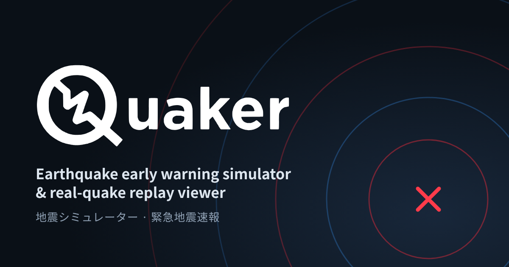

# Quaker

Earthquake early warning (EEW) simulator and real-quake replay viewer.

- Broadcast-style graphics in Japanese (with English subtitles) or fully in English
- Projects: every simulation saves itself in your browser, and preloaded scenarios, real quakes and imports each open as a new project
- Easy mode: presets, sliders, click the map to place the epicenter
- Advanced mode: a timeline editor for quakes, EEW reports, info boxes, camera keys and sound cues, with key-moment markers, multi-select, right-click menus, snapping, foldable tracks, a Reset all menu and an empty-timeline start
- Before the first EEW: light green detection boxes around the stations that felt it, then rough-estimate P and S circles that settle until the EEW takes over
- A realistic event sequence: S-wave arrival, EEW, intensity flash, epicenter info, the full report, then tsunami info, timed from the quake. Pick the steps in Easy mode, or build the run for any quake in Advanced
- Intro screen, plus title cards you can drop anywhere on the timeline: the boxes slide off, the map blurs behind the card, then everything slides back
- Camera: the auto camera keeps every quake that's going in frame by default (toggle it to follow just the newest), plus keyframes or a free map
- Boxes stack by importance (EEW on top, then the S-wave arrival, then the reports), and a second quake's EEW tucks in as a slim strip. When a side fills up it stays one column: the top box stays pinned and the rest cycle through underneath, or you scroll it yourself
- 64 real quakes from Japan and the US, plus USGS, P2PQuake and JMA feed import with step-by-step instructions
- Video recording, frame pictures, share codes and project files
- Your stuff on every device: settings, projects, sounds and fonts sync automatically through two secret gists on your GitHub account (paste a gist-only token once per device), or through your Claude account in the Claude version, and a backup file moves everything by hand
- Custom sounds for every alert, a sound per forecast shindo (so the EEW can sound different once it's a warning), and a different sound for each shindo level as the measured shaking climbs
- Custom fonts for the on-screen graphics: pick Google Fonts, a font installed on your computer, or import your own TTF, OTF, WOFF or WOFF2 files, separately for Japanese text, English text and numbers, each with its own size

Everything runs in the browser from one `index.html`. Station data, intensities and EEW reports are simulated, not real-time data.
